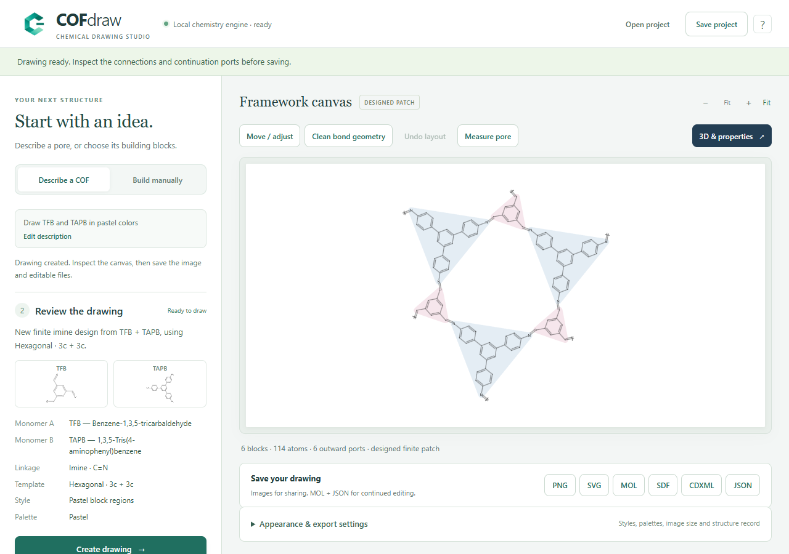
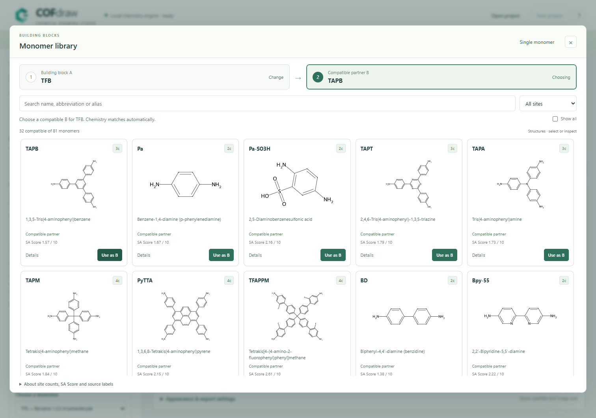
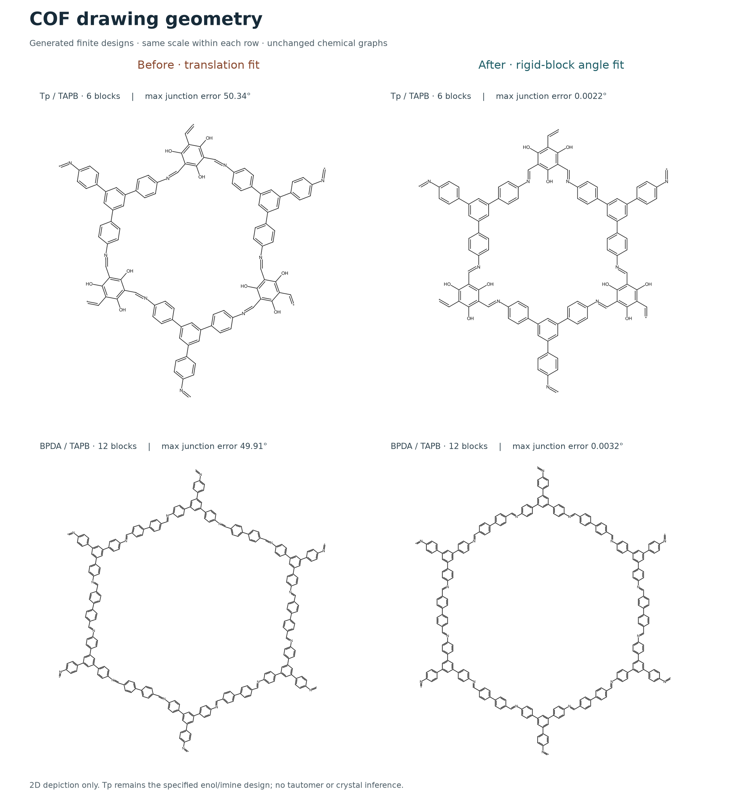
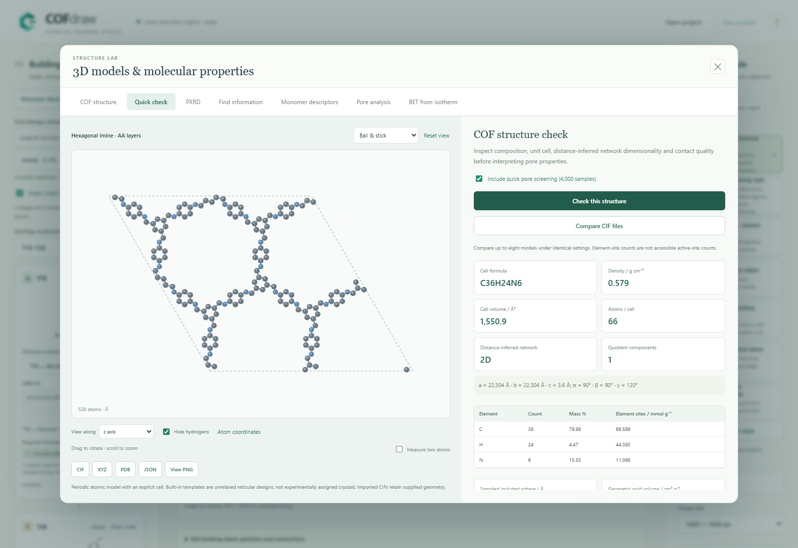
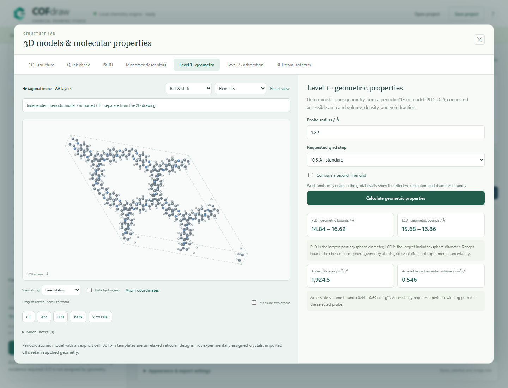
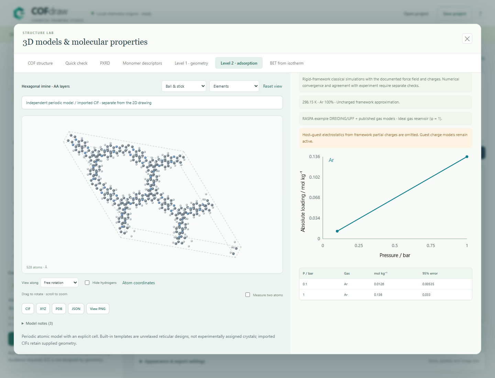
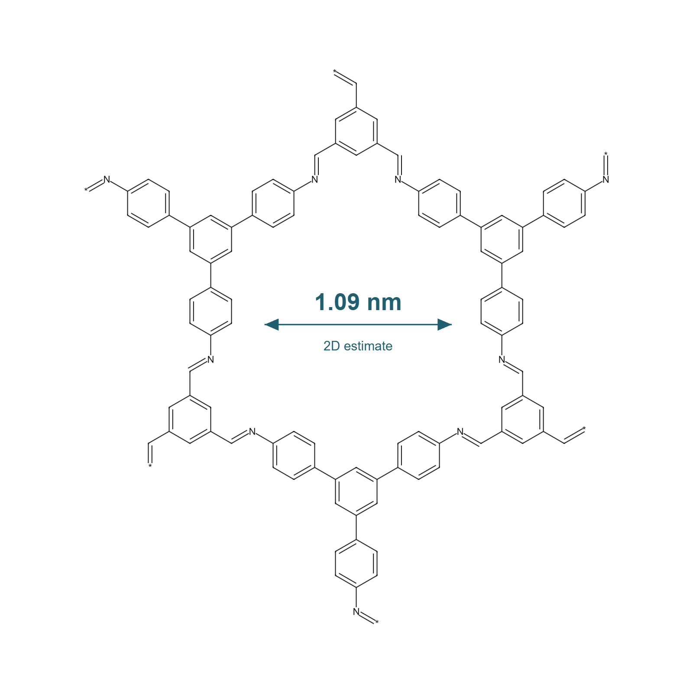

<p align="center">
  
</p>

<h1 align="center">COFdraw</h1>

<p align="center"><strong>A desktop drawing studio for covalent organic frameworks.</strong><br>
Describe a COF, review its building blocks, and draw. Explore 3D structures and materials properties.</p>

<p align="center">
  <a href="https://github.com/zzhenglab/COFdraw/releases/latest"></a>
  
  <a href="LICENSE"></a>
</p>

<p align="center">
  <a href="https://github.com/zzhenglab/COFdraw/releases/latest/download/COFdraw-Windows.zip"><strong>Download for Windows</strong></a>
  &nbsp; · &nbsp; <a href="docs/cofdraw-desktop-release.md">User guide</a>
  &nbsp; · &nbsp; <a href="skills/cofdraw/SKILL.md">Agent skill</a>
  &nbsp; · &nbsp; <a href="https://github.com/zzhenglab/COFdraw/issues">Report an issue</a>
</p>



## Download and run

1. Download **[COFdraw-Windows.zip](https://github.com/zzhenglab/COFdraw/releases/latest/download/COFdraw-Windows.zip)** from the latest release.
2. Extract the **entire ZIP** into a writable folder.
3. Open **`COFdraw.exe`** inside the extracted `COFdraw` folder.

**No Python installation is needed.** Keep `COFdraw.exe.config` beside the executable, along with the `_internal` and `data` folders. The ZIP is the ready-to-run desktop application; GitHub's automatically generated “Source code” archives are for developers.

The Windows application requires [Microsoft WebView2 Runtime](https://developer.microsoft.com/en-us/microsoft-edge/webview2/). Install it if the desktop window cannot open. Once the runtime is present, the bundled drawing tools and catalog work offline. The application runs its chemistry service locally on `127.0.0.1`.

Release assets include a SHA-256 checksum file. Troubleshooting and export details are in the [user guide](docs/cofdraw-desktop-release.md).

## What you can do

| Feature | Included in v0.7.0 |
| --- | --- |
| Describe a COF | Match sentences, monomer names, source names and style words to the local catalog; review before drawing |
| Optional LLM API | An OpenAI-compatible API can propose catalog parameters; the local chemistry engine validates them |
| Monomer library | 81 presets, structure cards, A-dependent compatible B choices, and automatic linkage/template selection |
| Precursor accessibility | Offline RDKit SA Score for finite monomers and declared precursor summaries; a heuristic, not ASKCOS or COF synthesis prediction |
| Reviewed drawings | 17 source-associated patches, including recovered manual alignments, Pyurea and UCOF |
| Geometry editing | Bond-angle-aware rigid-block layout, direct atom drag, block editing, undo, and geometry warnings |
| Presentation | 20 styles, 13 palettes, custom colors, source highlights, halos, and illustrative layers |
| Figure / chemical export | PNG, SVG, MOL, SDF, CDXML, and editable JSON |
| 3D structures | Current-drawing layers, stacking comparisons, multiple representations, periodic templates, CIF import and coordinate export |
| Network hypotheses | Explicit translated periodic copies with group colors and collision checks; interpenetration remains a qualified hypothesis |
| Pore geometry | Drawing-plane opening; periodic PLD/LCD bounds, transport-connected probe-center volume and sampled surface, with unresolved-grid status |
| Local adsorption | RASPA3 CPU jobs for Widom Henry coefficients, GCMC pressure points and mixture selectivity; optional finite-difference zero-loading heat, with saved inputs/outputs |
| BET | Fit supplied adsorption isotherms with consistency diagnostics |
| Monomer properties | RDKit descriptors, Gasteiger charges, ETKDG conformers, MMFF/UFF optimization, XYZ/SDF |
| COF quick checks | Formula, density, cell parameters, elemental site inventories, periodic connectivity and contact diagnostics |
| Powder diffraction | Model PXRD, d spacings, Miller indices and CSV export |
| Candidate comparison | Up to eight CIFs under common screening settings; CSV/JSON reports |
| Evidence and automation | Agent catalog queries, request schemas, saved-report retrieval and reusable agent skill |

Choose A, then pick from compatible B structures. The current pair stays visible while detailed review evidence remains expandable.



Source drawings retain their recorded coordinates and presentation. The restored Pyurea and UCOF layouts use source-informed block positions rather than forcing a rectangular or regular-hexagonal arrangement. These are qualified reconstructions, not exact image registrations. See the [recovered drawing catalog](docs/recovered-source-drawings.md).

The new layout preserves molecular blocks while correcting their connection angles. TpPa and TPB-DMTP also retain arrangements selected by comparison with the original figures. See the [geometry methods and comparisons](docs/drawing-geometry.md), [first 14 monomer additions](docs/manual-monomer-update.md), and [18 additions checked against the manual master records](docs/manual-master-crosscheck.md).





<details>
<summary>Geometric properties and local adsorption</summary>





</details>

<details>
<summary>Compare stacking styles and annotate a pore</summary>




</details>

For a materials-chemistry workflow, start with the [quick-check and screening guide](docs/materials-workflows.md). The [PXRD methods](docs/characterization-methods.md) and [periodic-network methods](docs/periodic-network-inspection.md) explain the calculations and their limits.

Read the [geometric-property definitions](docs/geometric-properties.md), [SA Score scope](docs/synthetic-accessibility.md), and [RASPA assumptions](docs/raspa-methods.md) before comparing candidates. A coarse-grid zero may mean unresolved transport. Short adsorption runs exercise the workflow; they do not establish converged predictions or experimental agreement.

The six implemented transforms cover imine, beta-ketoenamine, acylhydrazone, Tp keto-enamine–hydrazide, azine, and a selected reduced-imine secondary-amine product state. Broader linkage and topology catalogs also contain **reference-only entries**; those entries do not imply an available constructor.

<details>
<summary>Preview the monomer library</summary>


</details>

<details>
<summary>Recovered source alignment and highlights</summary>


</details>

## Start with a description

Choose **Describe a COF**, type a sentence or try a built-in example, then analyze it. For example:

> Draw TFB and TAPB with an imine linkage in pastel colors.

Review the matched building blocks, linkage, finite drawing layout and appearance before creating the drawing. Ambiguous names, unsupported chemistry and conflicting instructions require a choice instead of producing an invented structure. **Build manually** keeps the monomer editor and full construction controls available.

Rules mode works offline and needs no API key. Optional **LLM API** mode sends your description and a compact catalog to your chosen compatible endpoint only when requested. Supply your own endpoint, model and key; the application does not save the key or include it in projects and reports. The LLM proposes existing catalog IDs, and the same local chemical checks still apply. See [API setup and data handling](docs/llm-api.md).

## Use with an AI agent

Paste this into an agent that can read GitHub and run local tools:

```text
Use https://github.com/zzhenglab/COFdraw to draw a COF pore.
Read the repository's SKILL.md and follow the COFdraw skill.
Start with the bundled TFB–TAB source drawing and export PNG, SVG,
MOL, SDF, CDXML, and an editable JSON project to a new output folder.
```

The repository provides a root [`SKILL.md`](SKILL.md), [`AGENTS.md`](AGENTS.md), and the installable [`skills/cofdraw`](skills/cofdraw/SKILL.md) skill. The skill explains setup, library inspection, headless drawing, export, and the limits of chemical interpretation. A pasted link makes these instructions discoverable; automatic installation and execution depend on the agent's capabilities and permissions.

## Run from source

Use Python 3.11 on Windows x64. From a clone of this repository:

```powershell
py -3.11 -m venv .venv
.\.venv\Scripts\python.exe -m pip install -r requirements-cofdraw-desktop.txt
.\.venv\Scripts\python.exe scripts\launch_cofdraw.py --data-dir data
```

The reviewed portable catalog is included in `data/framework-drawing`. Source publications, private datasets, model weights, and training environments are not needed for this drawing application.

See [CONTRIBUTING.md](CONTRIBUTING.md) for tests and packaging. The Python import namespace remains `cof_vision` because COFdraw originated in that project; this repository contains the desktop drawing application.

## Scientific scope

COFdraw creates **finite molecular drawings with explicit continuation points**. A chosen template or a regular pore does not establish a unique periodic net, crystal structure, stacking arrangement, synthetic feasibility, or whole-material SMILES. Layered drawing styles and finite stacked patches are illustrations. The separate 3D laboratory imports explicit periodic structures and includes four unrelaxed model templates generated with pyCOFBuilder; these do not automatically identify the active 2D drawing as a crystal. Source identity is qualified by the supplied reference and is cleared when chemistry or connectivity changes.

**Geometric pore calculations and adsorption simulations are separate methods.** Grid bounds and surface estimates depend on the supplied structure, radii, probe and resolution. RASPA jobs use a rigid classical framework, explicit charge assumptions and a documented force field; they do not predict flexibility, chemisorption or synthesis. Zero-loading heat uses finite differences of independent Widom estimates, not a finite-loading heat curve. BET requires supplied isotherm data; geometric area is never labeled BET. Monomer SA Scores do not predict COF yield. xTB and quantum orbital energies are not bundled. Read the [scientific methods and limits](docs/scientific-methods.md).

CDXML preserves the checked chemical graph and continuation points, but does not reproduce every presentation style. Compatibility was checked with **ChemDraw 23.1.2.7**. Keep ChemDraw-edited framework boundaries in CDXML: ChemDraw's MOL save omitted external connection points in the recorded tests. Keep original MOL/SDF and project JSON files as well.

See [v0.5 validation](docs/v0.5-validation.json), [v0.4 validation](docs/v0.4-validation.json), the [catalog scope](docs/cofdraw-catalog-v3.md), [chemical export validation](docs/chemdraw-export-validation.md), [page-fit validation](docs/cofdraw-page-fit-validation.md), [original release validation](docs/cofdraw-release-validation.json), and [public-package verification](docs/publication-validation.json) for evidence and limitations.

## License and acknowledgments

Original application code is available under the [MIT License](LICENSE). The generated Gemmi IT92 coefficient module retains its [MPL-2.0 license](docs/third-party-licenses/Gemmi-MPL-2.0.txt); the Windows package includes its source and license. The RDKit SA Score retains its [Novartis BSD notice](docs/third-party-licenses/RDKit-SA-Score-BSD.txt). RASPA and force-field attribution are documented in the [adsorption methods](docs/raspa-methods.md). COFdraw uses RDKit, pywebview, FastAPI, and other open-source components; the Windows download includes their license notices. Generated periodic templates cite [pyCOFBuilder](https://github.com/lipelopesoliveira/pyCOFBuilder) and retain its attribution in `data/crystal-models`. Source publications and external materials retain their own rights. Catalog records preserve their source identifiers and provenance.
