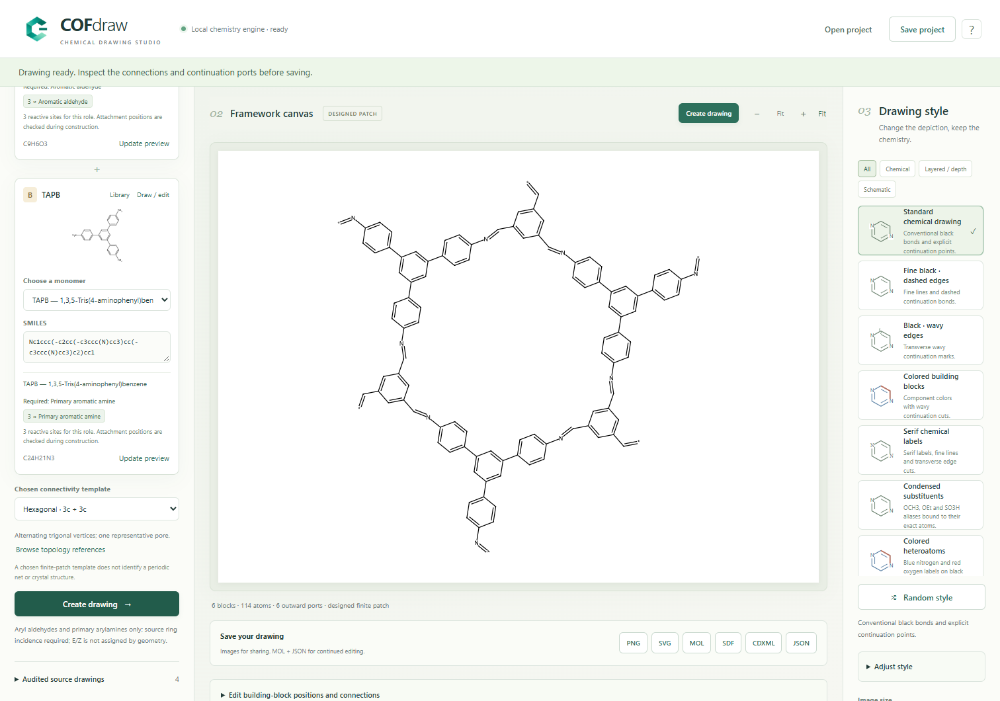
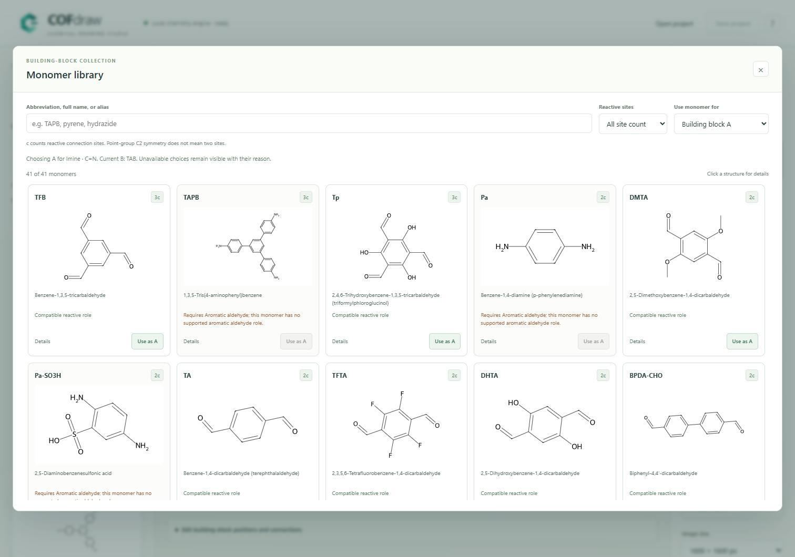

<p align="center">
  
</p>

<h1 align="center">COFdraw</h1>

<p align="center"><strong>A desktop drawing studio for covalent organic frameworks.</strong><br>
Build finite COF pore drawings, edit monomers, and export figures and chemical structures.</p>

<p align="center">
  <a href="https://github.com/zzhenglab/COFdraw/releases/latest"></a>
  
  <a href="LICENSE"></a>
</p>

<p align="center">
  <a href="https://github.com/zzhenglab/COFdraw/releases/latest/download/COFdraw-Windows.zip"><strong>Download for Windows</strong></a>
  &nbsp; · &nbsp; <a href="docs/cofdraw-desktop-release.md">User guide</a>
  &nbsp; · &nbsp; <a href="skills/cofdraw/SKILL.md">Agent skill</a>
  &nbsp; · &nbsp; <a href="https://github.com/zzhenglab/COFdraw/issues">Report an issue</a>
</p>



## Download and run

1. Download **[COFdraw-Windows.zip](https://github.com/zzhenglab/COFdraw/releases/latest/download/COFdraw-Windows.zip)** from the latest release.
2. Extract the **entire ZIP** into a writable folder.
3. Open **`COFdraw.exe`** inside the extracted `COFdraw` folder.

**No Python installation is needed.** Keep the executable, `_internal`, and `data` folders together. The ZIP is the ready-to-run desktop application; GitHub's automatically generated “Source code” archives are for developers.

The Windows application requires [Microsoft WebView2 Runtime](https://developer.microsoft.com/en-us/microsoft-edge/webview2/). Install it if the desktop window cannot open. Once the runtime is present, the bundled drawing tools and catalog work offline. The application runs its chemistry service locally on `127.0.0.1`.

Release assets include a SHA-256 checksum file. Troubleshooting and export details are in the [user guide](docs/cofdraw-desktop-release.md).

## What you can do

| Feature | Included in v0.3.0 |
| --- | --- |
| Monomer library | 41 presets, searchable structure cards, and compatibility guidance |
| Monomer editing | Enter SMILES, import MOL, or use the atom/bond editor |
| Starting drawings | Four source-associated pores and eight design starting pairs |
| Construction | Seven explicit connectivity templates and six scoped automatic chemical transforms |
| Presentation | 17 styles, with color, font, line, label, and boundary controls |
| Figure export | PNG and SVG |
| Chemical export | MOL, SDF, and CDXML |
| Editable projects | Save and reopen JSON projects |
| Automation | Local HTTP API and a reusable agent skill |

The six implemented transforms cover imine, beta-ketoenamine, acylhydrazone, Tp keto-enamine–hydrazide, azine, and a selected reduced-imine secondary-amine product state. Broader linkage and topology catalogs also contain **reference-only entries**; those entries do not imply an available constructor.

<details>
<summary>Preview the monomer library</summary>



</details>

## Use with an AI agent

Paste this into an agent that can read GitHub and run local tools:

```text
Use https://github.com/zzhenglab/COFdraw to draw a COF pore.
Read the repository's SKILL.md and follow the COFdraw skill.
Start with the bundled TFB–TAB source drawing and export PNG, SVG,
MOL, SDF, CDXML, and an editable JSON project to a new output folder.
```

The repository provides a root [`SKILL.md`](SKILL.md), [`AGENTS.md`](AGENTS.md), and the installable [`skills/cofdraw`](skills/cofdraw/SKILL.md) skill. The skill explains setup, library inspection, headless drawing, export, and the limits of chemical interpretation. A pasted link makes these instructions discoverable; automatic installation and execution depend on the agent's capabilities and permissions.

## Run from source

Use Python 3.11 on Windows x64. From a clone of this repository:

```powershell
py -3.11 -m venv .venv
.\.venv\Scripts\python.exe -m pip install -r requirements-cofdraw-desktop.txt
.\.venv\Scripts\python.exe scripts\launch_cofdraw.py --data-dir data
```

The reviewed portable catalog is included in `data/framework-drawing`. Source publications, private datasets, model weights, and training environments are not needed for this drawing application.

See [CONTRIBUTING.md](CONTRIBUTING.md) for tests and packaging. The Python import namespace remains `cof_vision` because COFdraw originated in that project; this repository contains the desktop drawing application.

## Scientific scope

COFdraw creates **finite molecular drawings with explicit continuation points**. A chosen template or a regular pore does not establish a unique periodic net, crystal structure, stacking arrangement, synthetic feasibility, or whole-material SMILES. Layered and cartoon views are illustrations. Source identity is qualified by the supplied reference and is cleared when chemistry or connectivity changes.

CDXML preserves the checked chemical graph and continuation points, but does not reproduce every presentation style. Compatibility was checked with **ChemDraw 23.1.2.7**. Keep ChemDraw-edited framework boundaries in CDXML: ChemDraw's MOL save omitted external connection points in the recorded tests. Keep original MOL/SDF and project JSON files as well.

See the [catalog scope](docs/cofdraw-catalog-v3.md), [chemical export validation](docs/chemdraw-export-validation.md), [page-fit validation](docs/cofdraw-page-fit-validation.md), [original release validation](docs/cofdraw-release-validation.json), and [public-package verification](docs/publication-validation.json) for evidence and limitations.

## License and acknowledgments

Original project code is available under the [MIT License](LICENSE). COFdraw uses RDKit, pywebview, FastAPI, and other open-source components; the Windows download includes their license notices. Source publications and external materials retain their own rights. Catalog records preserve their source identifiers and provenance.
