<p align="center"></p>

# COFdraw

Draw covalent organic frameworks from their building blocks, explore periodic crystal models, and compare simulated properties. The desktop app opens in a 2D chemical drawing workspace. You can start with monomers, a COF name, a COFex record, or a description. The drawing engine and catalog run locally.

**[Download for Windows](https://github.com/zzhenglab/COFdraw/releases/download/v0.10.7/COFdraw-Windows.zip)** · **[Download for Mac (beta)](https://github.com/zzhenglab/COFdraw/releases/tag/v0.10.7-mac-beta.21)** · **[Download the screening dataset](https://github.com/zzhenglab/COFdraw/releases/tag/screening-2026-11-25)**

**405 monomers · 38 topology entries · 24,760 hypothetical periodic CIFs.** For an agent, paste this repository URL and ask it to read [SKILL.md](SKILL.md). For a paper, pin the software version and dataset snapshot under [Citing COFdraw](#citing-cofdraw).

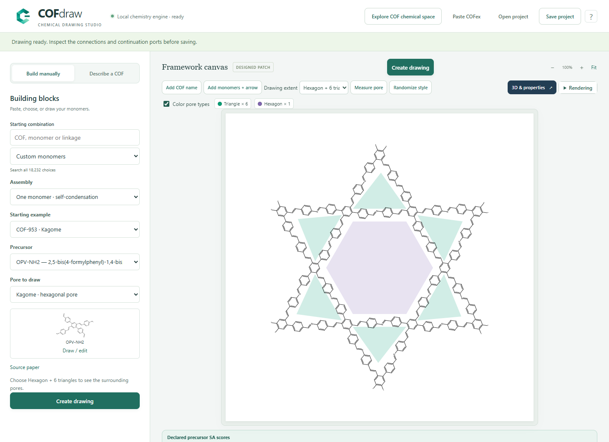

*Try this drawing:* In **Build manually**, choose **One monomer · self-condensation**, select **COF-953 · Kagome**, then choose **Hexagon + 6 triangles** under **Drawing extent**. Each triangular pore shares an edge with the central hexagon.

**[Drawing gallery](#drawing-gallery)** · **[Monomers and topology](#monomers-and-topology)** · **[3D and properties](#3d-diffraction-and-gas-sorption)** · **[Linkage explorer](#explore-chemical-space-by-linkage)** · **[Hypothetical database](#explore-the-screening-dataset)**

## Drawing gallery

| TpPa · Reaction scheme | F-COF-1 · Source-style highlights |
| :---: | :---: |
| [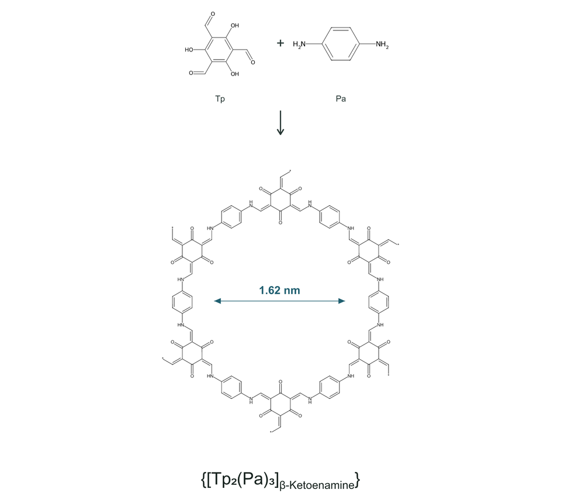](docs/assets/gallery-tppa-reaction.png) | [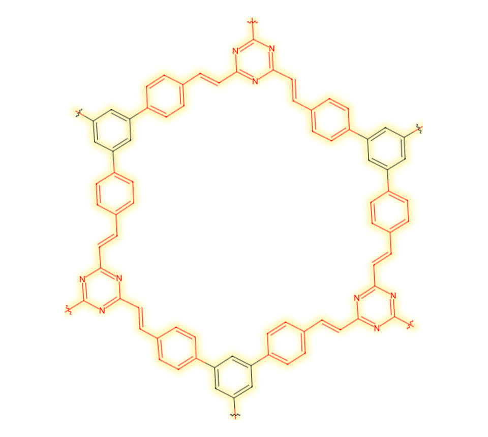](docs/assets/gallery-f-cof-1-highlight.png) |
| A precursor scheme and the measured opening in the drawing plane. | A recovered drawing that preserves the source bond colors and decorative halo. [Drawing notes](docs/recovered-source-drawings.md) |

| COF-300 · Source-informed 2D drawing | COF-300 · Periodic crystal view |
| :---: | :---: |
| [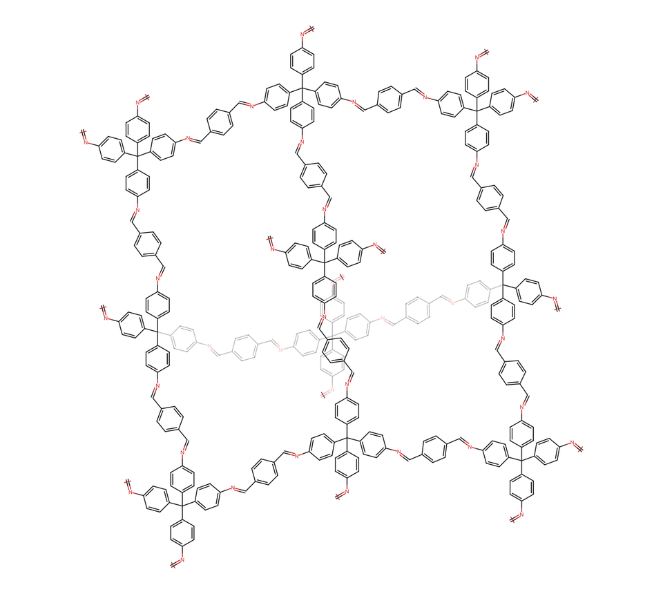](docs/assets/gallery-cof-300-projection.png) | [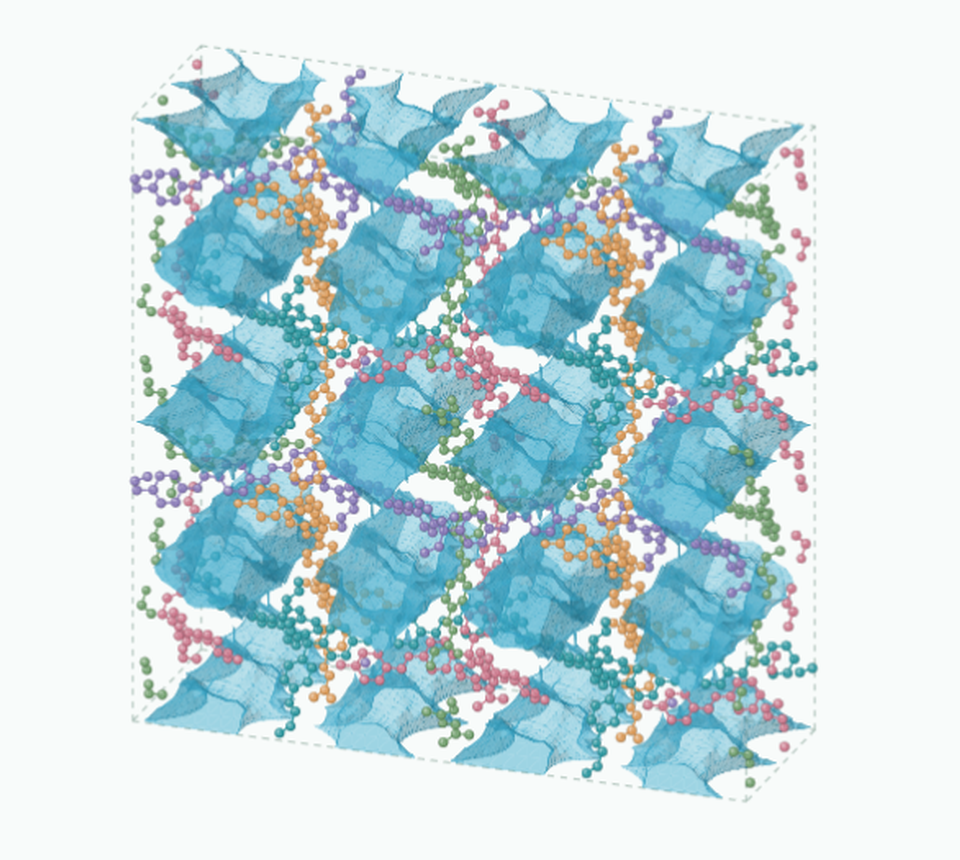](docs/assets/gallery-cof-300-crystal.png) |
| This reviewed finite drawing shows the tetrahedral junctions, bis-imine linkers, and faded rear branch of the published scheme. [Source scheme](https://doi.org/10.1021/acsami.3c12826) · [Drawing notes](docs/recovered-source-drawings.md) | The fivefold phase reported in 2009, shown with a pore-surface overlay. [Supporting CIF](https://doi.org/10.1021/ja8096256.s002) |

### Color and drawing extent

The **Rendering** controls sit below the drawing. Four presets on the same TFB–TAPB graph show how color and depth change the figure. The layer and sphere effects are illustrations.

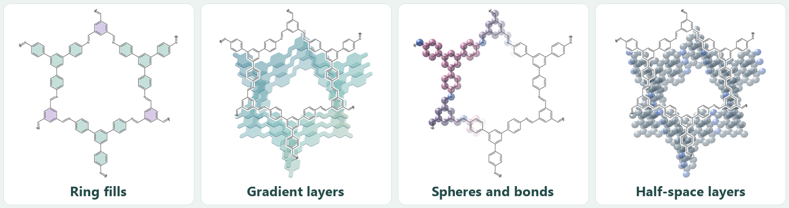

Full-size views · [Ring fills](docs/assets/gallery-aromatic-ring-fills.png) · [Gradient layers](docs/assets/gallery-gradient-layers.png) · [Spheres and bonds](docs/assets/gallery-spheres-and-bonds.png) · [Half-space layers](docs/assets/gallery-half-space-layers.png)

**Aromatic ring palettes.** Within **Filled aromatic rings**, change only the palette to distinguish the two building blocks. The four panels share identical connectivity and layout.

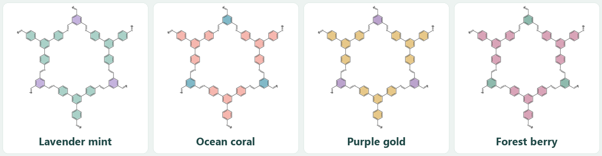

Imine drawings use bent C=N junctions. For equivalent node arms and straight linkers, the layout seeks consistent turns around the node and opposite-sided bends across the linker. Crowded projections still need visual review.

**Drawing extent** expands a single motif into its connected neighborhood. The SIOC-COF example opens up both triangular and hexagonal pores in the same 2D patch.

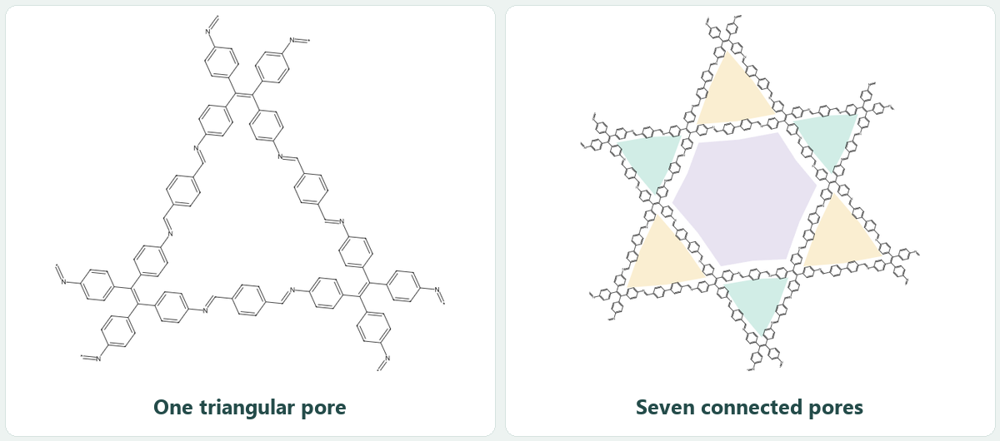

## Monomers and topology

Use **Draw / edit** to build a monomer with atoms, bonds, and templates. In the **Monomer library**, filter by **Connectivity** and **Functional group** independently or together. For example, choose **3-connected** and **Aldehyde** to find TFB. When choosing a compatible partner, the functional group filter follows the role each candidate can play in the selected linkage. Each card includes the monomer’s aliases and source records.

[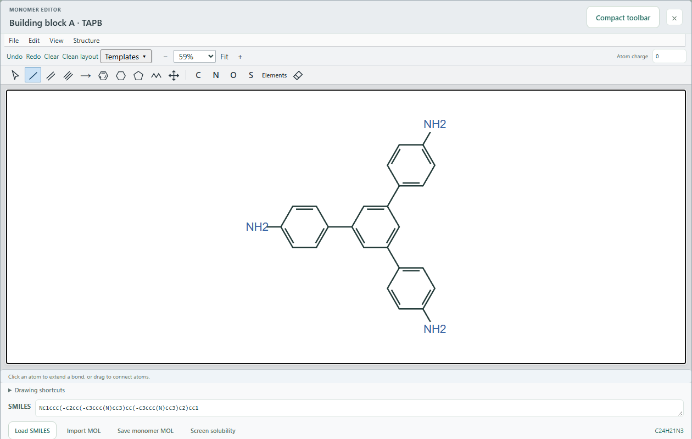](docs/assets/feature-monomer-editor.png)

[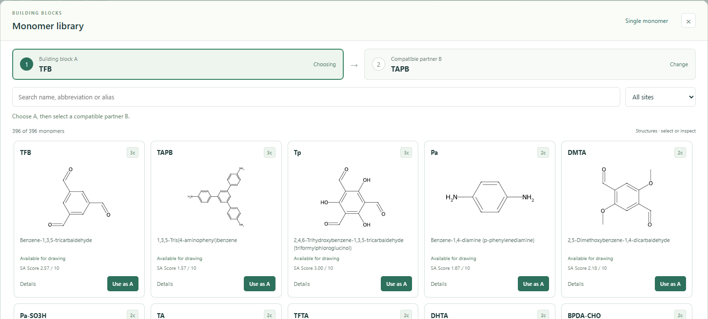](docs/assets/feature-monomer-library.png)

| Monomer class or eligibility · v0.10.7 | Structures |
| --- | ---: |
| **Distinct monomer structures** | **405** |
| Eligible for at least one binary drawing role | 319 |
| Aromatic aldehydes | 151 |
| Primary aromatic amines | 127 |
| Nitriles | 25 |
| Arylboronic acids | 22 |
| Terminal acylhydrazides | 18 |
| Aromatic vicinal diols | 10 |
| Aromatic carboxylic acids | 10 |
| Primary aliphatic amines | 5 |

The table counts structural motifs in distinct monomers. Classes overlap. The **Functional group** filter uses framework-forming roles, so its counts can differ from the table. A compatible role checks functional groups. Automatic matching also considers the selected linkage, attachment-site count, and geometry before proposing a supported drawing template.

**Browse topology references** to compare node geometry and net diagrams. The library API exposes **38 topology entries** and **26 drawing templates**. The browser marks reference entries and supports design choices such as honeycomb, square, and kagome layouts. For compatible monomers, the picker offers geometries such as dia for a tetrahedral node and a linear spacer, pts for tetrahedral and square-planar nodes, and sql or kgm for eligible planar four-connected nodes with linear spacers. The canvas shows molecular projections of dia and pts. Open **3D & properties** to rotate those fragments. Assigning an experimental topology requires structural evidence. [Net geometries and supporting literature](docs/topology-priorities.md)

[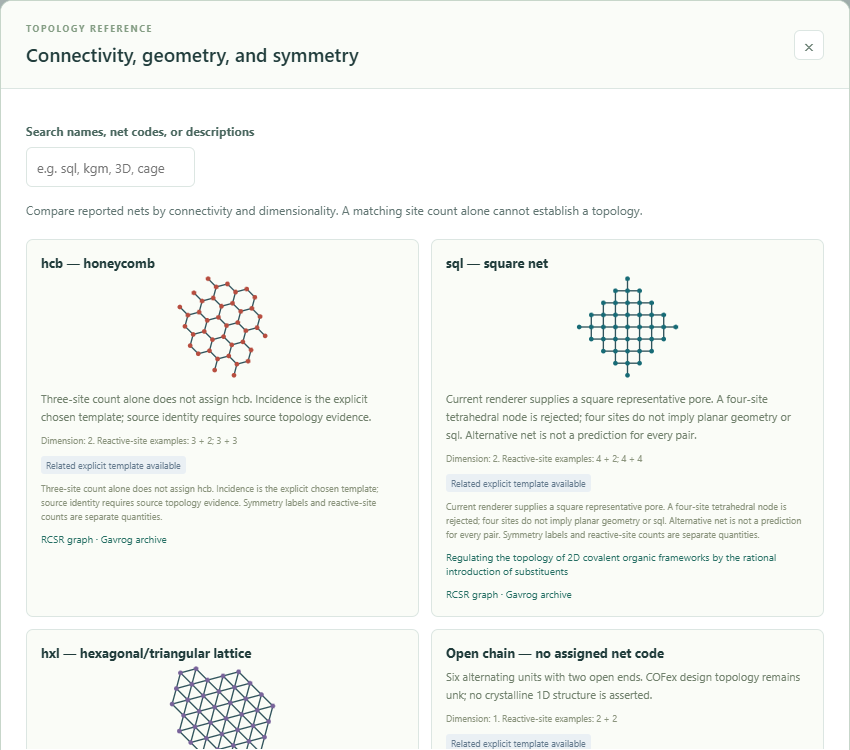](docs/assets/feature-topology-browser.png)

## 3D, diffraction and gas sorption

**From drawing to periodic CIF.** A 2D COF can form a periodic crystal of stacked sheets. COFdraw generated the unrelaxed DMTP–TAPB AA cell below from the same precursor pair as the chemical drawing. For a three-dimensional covalent net, the COF‑300 example below uses the published CIF. Both workflows support CIF export and structure analysis. [Materials workflows](docs/materials-workflows.md)

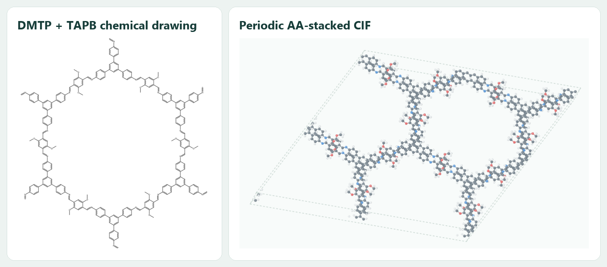

**Pore surface and volume.** Map probe-center voids in the periodic viewer, then open **Pore geometry** for limiting and cavity diameters, accessible volume, surface area, and void fraction. The example uses the same DMTP–TAPB cell. Values depend on the probe and grid, and gas uptake comes from a separate adsorption calculation. [Geometric methods and property definitions](docs/geometric-properties.md)

[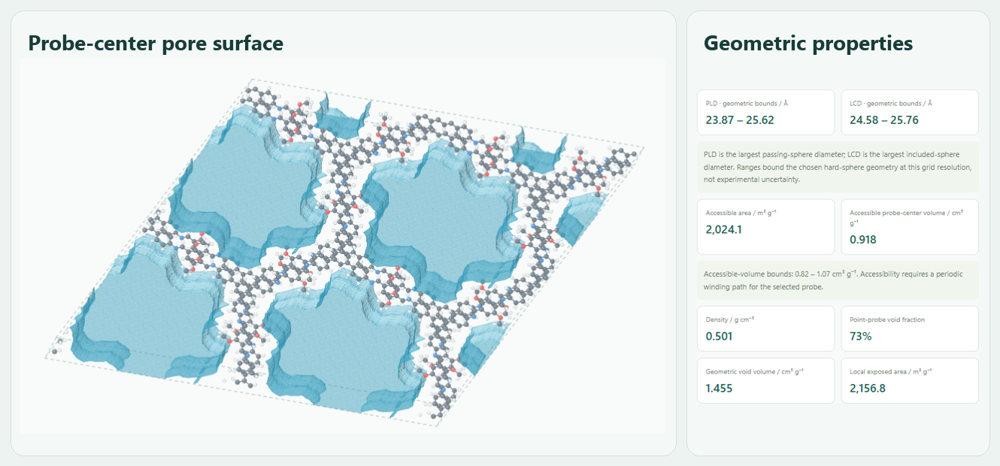](docs/assets/feature-pore-surface-volume.png)

**3D crystal views.** Rotate a structure, color its interpenetrating networks, or switch to a simplified topology. These two COF‑300 views show the published fivefold phase and a local set of connected tetrahedral junctions. [Supporting CIF](https://doi.org/10.1021/ja8096256.s002)

[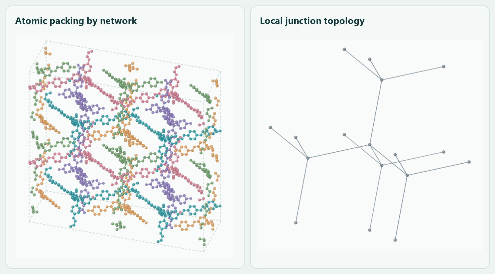](docs/assets/feature-cof-300-network-views.png)

**Powder diffraction.** In **3D & properties → PXRD**, compare calculated AA, AB, ABC, and slipped packing patterns for a TFB–TAPB model. The separation slider spreads the traces vertically and the low-angle control zooms into the first peaks. [PXRD methods](docs/characterization-methods.md)

[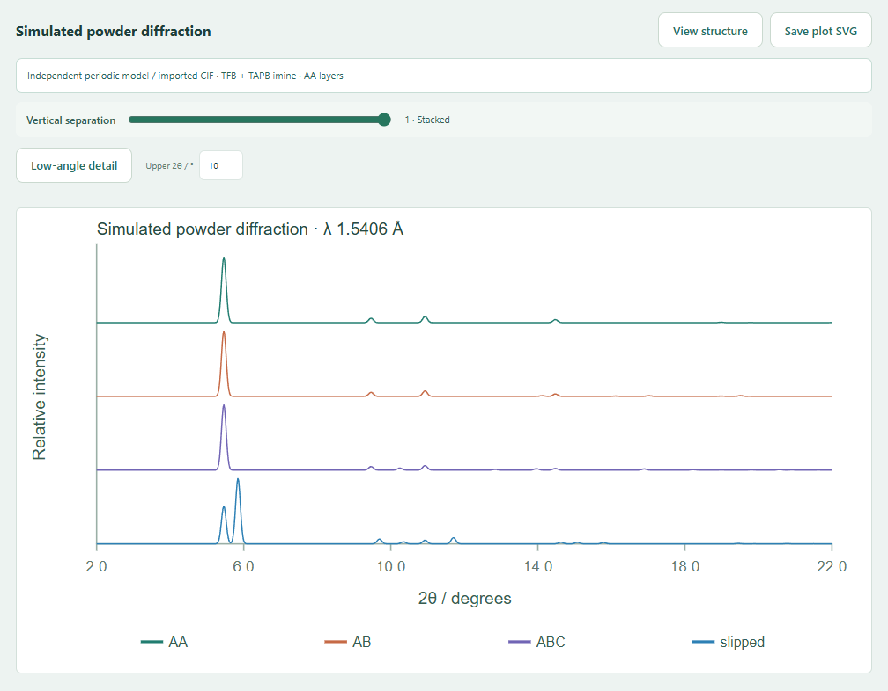](docs/assets/feature-stacking-pxrd.png)

**Gas sorption.** The **Gas adsorption** panel ran RASPA3 for pure methane at seven pressures from 0.1 to 20 bar. The figure shows absolute loading from a short demonstration with a rigid, uncharged TFB–TAPB model and an ideal-gas reservoir. Error bars are internal sampling intervals from this run. [Force fields, charges, and simulation settings](docs/raspa-methods.md)

[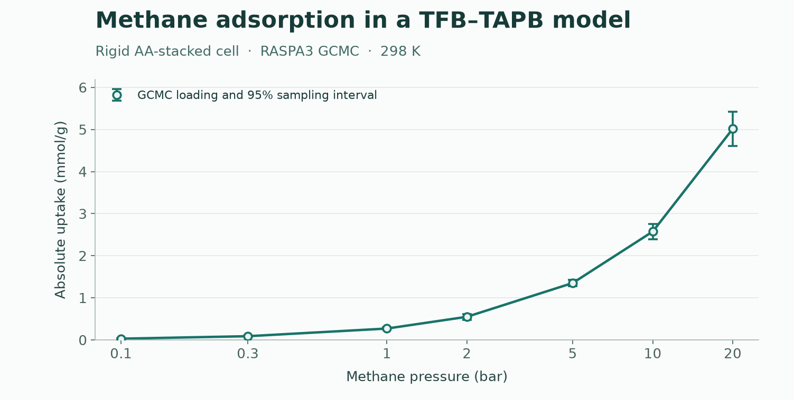](docs/assets/feature-methane-sorption.png)

## Explore chemical space by linkage

Open **Explore COF chemical space** to browse families by their reaction schemes. Select a family to inspect which building-block pairs were screened as eligible, which have indexed reports, and which have both kinds of evidence. Select a heatmap cell to see the precursor structures and available literature entries.

[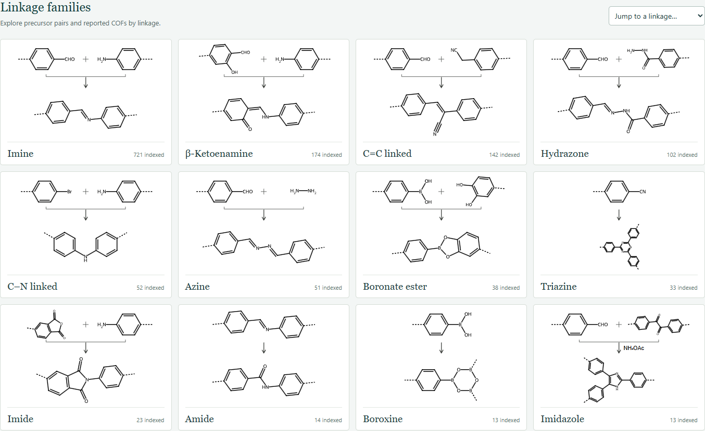](docs/assets/feature-linkage-families.png)

[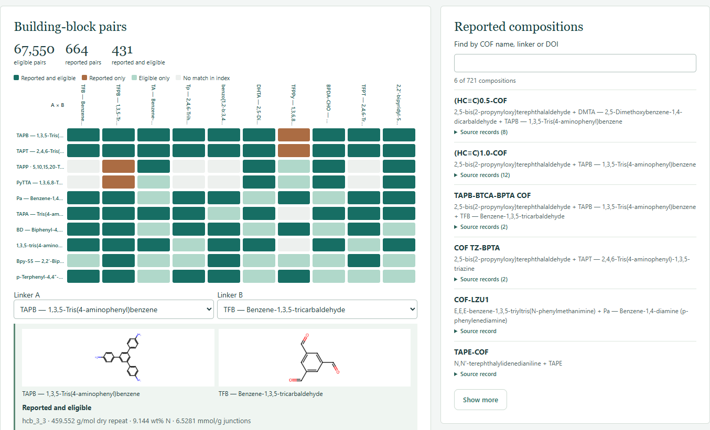](docs/assets/feature-imine-pairs.png)

The linkage gallery draws on the classification and reaction schemes discussed by Ke Tian Tan, Donglin Jiang and coauthors, especially Figure 3 of their 2023 Primer. [Covalent organic frameworks, Nature Reviews Methods Primers 3, 1](https://doi.org/10.1038/s43586-022-00181-z)

## Run the desktop app

| Platform | First launch |
| --- | --- |
| Windows x64 | Extract the **entire ZIP** to a writable folder and open `COFdraw.exe`. Keep `COFdraw.exe.config`, `_internal`, and `data` beside it. The package includes Python. [Windows startup help](docs/windows-startup.md) |
| macOS beta | Choose the [Apple silicon (arm64) ZIP](https://github.com/zzhenglab/COFdraw/releases/download/v0.10.7-mac-beta.21/COFdraw-macOS-arm64.zip) or the [Intel (x86_64) ZIP](https://github.com/zzhenglab/COFdraw/releases/download/v0.10.7-mac-beta.21/COFdraw-macOS-x86_64.zip). Extract the ZIP, move **COFdraw.app** to Applications, and follow the first-open instructions for your build. [Mac beta downloads and tested macOS versions](https://github.com/zzhenglab/COFdraw/releases/tag/v0.10.7-mac-beta.21) |

## From building blocks to a figure

| If you want to… | In COFdraw |
| --- | --- |
| Draw or edit a COF | Choose a starting combination or draw monomer A and pick a compatible B. Automatic matching suggests a linkage and a layout. **Drawing extent** shows the neighboring pores supported by that topology. |
| Work from a name or a description | Open **Describe a COF** and try “Draw TFB and TAPB with an imine linkage in pastel colors.” Review the matched structures before applying. Local rules work offline. GPT and Claude are optional. [API setup and data handling](docs/llm-api.md) |
| Prepare a figure | Add precursor structures and a reaction arrow, label the COF, measure the drawn opening, or adjust the palette and geometry. Export SVG or PNG for a figure, CDXML for ChemDraw, MOL/SDF for the finite chemical graph, or project JSON to resume editing. [Chemical export guide](docs/chemdraw-export-validation.md) |
| Examine a crystal | Open **3D & properties**. Build an unrelaxed periodic model for a supported design or import a CIF. Inspect the cell, compare stacking and PXRD, and screen pore dimensions, accessible volume, and surface area. [Materials workflows](docs/materials-workflows.md) |
| Compare chemistry or adsorption | Inspect monomer descriptors and synthetic accessibility, or run local RASPA adsorption calculations with documented force-field and charge settings. BET fitting uses a supplied adsorption isotherm. [Scientific methods](docs/scientific-methods.md) |

<details>
<summary>See the geometry and layer-stacking examples</summary>


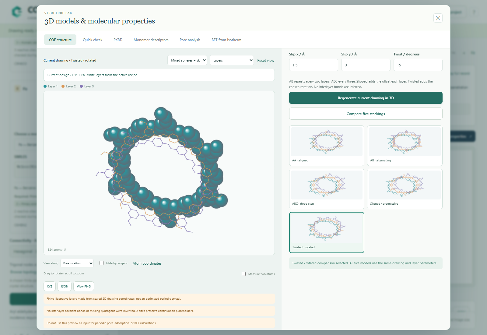

</details>

## Explore the screening dataset

The **November 25, 2026 checkpoint** records all **45,439 eligible construction outcomes**, with **24,760 unique periodic CIFs** for generated, unrelaxed AA-stacked sheets. **19,270** have a first-pass gas screen in this snapshot. Each coordinate file is linked to its precursor SMILES and proposed net through the CSV index. The index also records rejected builds and held calculations. Empty property fields mean the result is unavailable. [Coverage and methods](benchmarks/screening-2026-11-25.md)

| Hypothetical design family | Recorded outcomes | Periodic CIFs |
| --- | ---: | ---: |
| Imine | 39,938 | 21,039 |
| Hydrazone | 5,001 | 3,350 |
| β-Ketoenamine | 217 | 147 |
| Azine | 122 | 97 |
| Nitrone | 122 | 93 |
| Keto-hydrazide | 39 | 34 |
| **Total** | **45,439** | **24,760** |

The 1,133-model follow-up adds seven-pressure methane isotherms and three-seed equimolar CH₄/H₂ mixture calculations. The temperature and paired force-field studies are complete. At this checkpoint, **2,811** newly built CIFs were still queued for the first-pass gas screen. The public collection uses proposed honeycomb and square sheets. The bundled 3D reference crystals are a separate collection.

| Download | How to use it |
| --- | --- |
| [CIFs and property index (ZIP)](https://github.com/zzhenglab/COFdraw/releases/download/screening-2026-11-25/COFdraw-screening-CIFs.zip) | Open `results.csv` and use the `cif` column to find a model. The `cif_sha256` column identifies its exact coordinates. |
| [COFdraw results file (JSON.GZ)](https://github.com/zzhenglab/COFdraw/releases/download/screening-2026-11-25/research-screen.json.gz) | In **Explore COF chemical space → Simulation results → Open results file**, select the compressed file directly. |

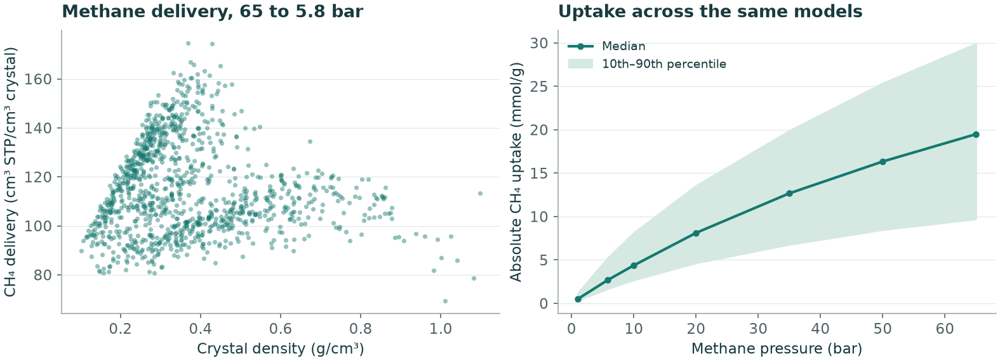

*Reading the figure.* Each point on the left is one of the **1,133 selected models** with a three-seed, seven-pressure methane isotherm at 298 K. Median predicted delivery from 65 to 5.8 bar is **111.6 cm³(STP) per cm³ of ideal crystal**. On the right, the shaded band shows variation across frameworks at each pressure. Both panels use the downloadable CSV.

**Interpreting a design.** A drawing records a finite patch and its continuation points. A COFex string identifies precursors and carries the assigned net and catenation when known. Periodic properties depend on the particular CIF, packing, and simulation settings. A literature precedent for a precursor pair does not establish that a proposed crystal has been synthesized. [Pore definitions](docs/geometric-properties.md) · [Adsorption assumptions](docs/raspa-methods.md)

## Use with an AI agent

Paste this request into an agent with access to GitHub and local tools.

> Use https://github.com/zzhenglab/COFdraw and read its SKILL.md. Find the reviewed TpPa drawing, render it in Standard style, and save SVG, PNG, available editable chemical formats, and the JSON with provenance. Then compare a separate custom design from my monomer SMILES. Report the chosen linkage, topology options, continuation points, and the files you actually generated.

| Agent workflow | What to ask for |
| --- | --- |
| **Find a structure** | Look up a COF name, DOI, precursor, or linkage. Return the catalog IDs, exact SMILES, and source qualifications. |
| **Reproduce a reviewed drawing** | Use the source recipe and preserve its layout and continuation points. Export PNG and SVG for figures, MOL/SDF or available CDXML for editing, and the recipe and audit JSON. |
| **Draw from custom monomers or COFex** | Resolve the actual precursors, inspect linkage and topology choices, and prepare a finite drawing. Use **Drawing extent** or the repeat API to expand supported pores. Keep the compact COFex for exchange and the full record for the selected construction. |
| **Work with a periodic model** | Build a supported periodic CIF or inspect a supplied CIF. Calculate ideal PXRD or geometric bounds with explicit settings. Preserve the model, its hash, and its assumptions. |
| **Run and retrieve calculations** | Check local engine availability, run a scoped job, and return the report and its supporting files. For adsorption, retain the force field, charges, gas conditions, and archived inputs and outputs. |

From a source checkout with its dependencies installed, the helper can query the catalog and make an actual reference drawing headlessly. Use a new output directory for each invocation.

```sh
python skills/cofdraw/scripts/cofdraw_client.py --repo . --output outputs/library library
python skills/cofdraw/scripts/cofdraw_client.py --repo . --output outputs/tppa source tppa-pore-v1 --style standard --size 1200
```

On Windows the helper also accepts `--exe` with the path to the extracted desktop application. Agent hosts that install skills can load the entire `skills/cofdraw` directory. A browser-only agent can inspect the documentation, and a host with local execution can produce the files. [Installable skill](skills/cofdraw/SKILL.md) · [Agent workflows](skills/cofdraw/references/agent-workflows.md) · [Drawing API](skills/cofdraw/references/local-api.md) · [Science API](skills/cofdraw/references/science-api.md)

## Citing COFdraw

- **Software.** zzhenglab (2026). *COFdraw*, version 0.10.7. Cite the release you ran. [Release](https://github.com/zzhenglab/COFdraw/releases/tag/v0.10.7) · [Machine-readable citation](CITATION.cff)
- **Dataset.** zzhenglab (2026). *COFdraw hypothetical COF screening dataset*, snapshot `screening-2026-11-25`. For individual structures, report the record ID and CIF SHA‑256. [Versioned dataset](https://github.com/zzhenglab/COFdraw/releases/tag/screening-2026-11-25)
- **Linkage chemistry.** Tan, K. T. et al. (2023). *Covalent organic frameworks*. Nature Reviews Methods Primers **3**, 1. [DOI](https://doi.org/10.1038/s43586-022-00181-z)

## Run from source

For Windows development, use Python 3.11 from the repository root.

```powershell
py -3.11 -m venv .venv
.\.venv\Scripts\python.exe -m pip install -r requirements-cofdraw-desktop.txt
.\.venv\Scripts\python.exe scripts\launch_cofdraw.py --data-dir data
```

[User guide](docs/cofdraw-desktop-release.md) · [Contributing and tests](CONTRIBUTING.md) · [All releases](https://github.com/zzhenglab/COFdraw/releases) · [Report an issue](https://github.com/zzhenglab/COFdraw/issues)

## License and acknowledgments

COFdraw application code is distributed under the [MIT License](LICENSE). The desktop package includes third-party notices. The Gemmi IT92 coefficients retain their [MPL-2.0 license](docs/third-party-licenses/Gemmi-MPL-2.0.txt), the RDKit SA Score retains its [Novartis BSD notice](docs/third-party-licenses/RDKit-SA-Score-BSD.txt), and periodic templates credit [pyCOFBuilder](https://github.com/lipelopesoliveira/pyCOFBuilder). Catalog records retain their publication identifiers. [RASPA and force-field attribution](docs/raspa-methods.md)
