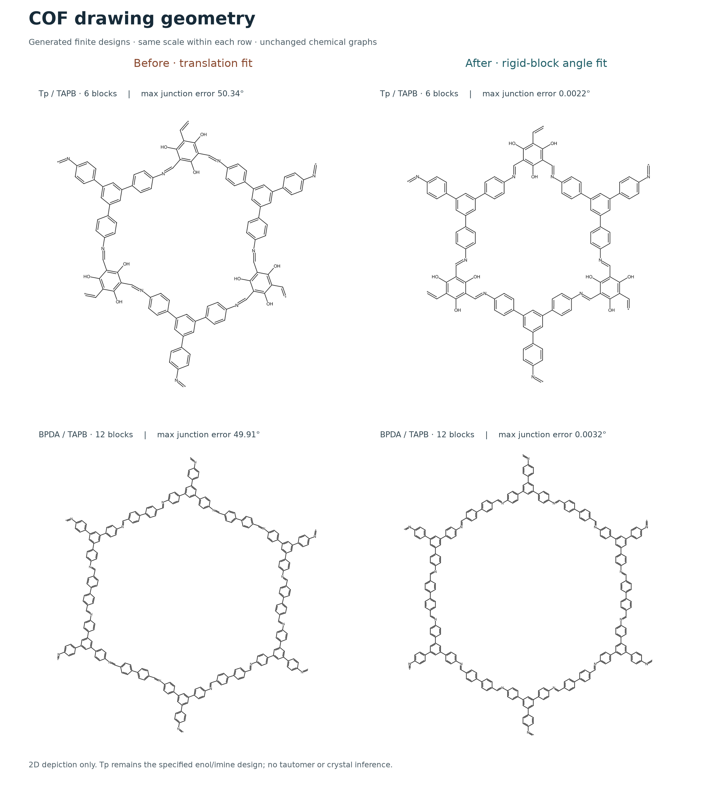

# Drawing geometry

COFdraw fits whole molecular blocks to improve junction angles while preserving each block's real-atom geometry. The following are generated finite designs with identical chemical graphs before and after the fit. Each row uses the same canvas and molecular scale; no source publication image is included.

The six-block Tp/TAPB imine design retains the supplied enol form. BPDA denotes biphenyl-4,4′-dicarbaldehyde. These examples do not establish experimental products or crystal structures. Their maximum junction-angle deviations fall from 50.335° to 0.0022° and from 49.908° to 0.0033°, respectively. Both fitted designs have no detected atom overlaps or bond crossings; junction lengths differ from the reference bond length by less than 0.0033%.

## Deterministic rigid-block fitting

Porphyrin monomers use RDKit's built-in ring templates before rigid-block fitting. This keeps the four pyrrole rings balanced and the inner nitrogen atoms directed toward the center; it changes depiction coordinates, not connectivity, hydrogen counts, or tautomer assignments. Imported coordinates are retained unless **Clean layout** is requested. Saved source coordinates still take precedence.

New assembled designs and explicit **Clean layout** requests use `bond_angle_pose_v2`. The implementation orients blocks using the actual retained attachment atoms, handles linear linkers with a stable proper rotation, and evaluates four deterministic patterns of unspecified connection-side choices. A damped Gauss–Newton fit adjusts only whole-block rotations and translations. It neither stretches aromatic rings nor assigns E/Z stereochemistry. Explicit stereochemistry bypasses automatic angle reorientation and remains flagged for review.

A candidate must improve the combined angle/length score, keep junction-length error within 12%, and introduce no new nonbonded overlaps or proper crossings between nonincident bond segments. The audit reports `quality: regular` only when maximum junction-angle deviation is at most 15°, junction-length error is at most 12%, and no overlaps or crossings are detected. Otherwise it reports `needs_review`. These are depiction checks, not physical strain limits or guarantees of legibility. Angle references are 180° for SP atoms, 109.5° for SP3 atoms and 120° otherwise; the overlap threshold is 0.35 times the median bond length.

The [geometry regression tests](../tests/test_cofdraw_geometry_regression.py) independently check graph/stereo fields, real intrablock distances, junction angles, bond lengths and repeat-arm symmetry. For the long-linker example, equivalent phenyl axes should be parallel with consistent offsets; forcing all ring centers onto a straight line would conflict with its 120° junction geometry.

## Selecting source-informed revisions

Ideal geometry alone cannot identify the arrangement in a source drawing. The TpPa and TPB–DMTP revisions were separately compared with their original plots using six approximate ring-center landmarks and a single global similarity alignment. Bond-centerline samples were compared with the nearest source ink; there was no local warp. TpPa's generic best-scoring candidate had good angles but a poorer visual match, so all four candidate patterns were reviewed and pattern 0 was retained.

| Source recipe | Atoms | Mean centerline-to-ink distance, before → after | Maximum fitted junction deviation |
| --- | ---: | ---: | ---: |
| `tppa-pore-v1` | 126 | 1.18 → 0.10 px | 0.0056° |
| `tpb-dmtp-cof-pore-v1` | 234 | 3.97 → 0.25 px | 0.0027° |

Both revisions retain their chemical graphs, real intrablock distances and source orientation, with no detected overlaps or crossings. The pixel metric is a one-sided raster proxy dependent on the source crop, landmarks and ink threshold. It is not atomwise registration or an accuracy estimate for an experimental structure. Both remain `source_registered: false` and agent-reviewed, not human ground truth. The [coordinate-revision audit](../data/framework-drawing/catalog/source-layout-revisions.audit.json) binds the selected candidates, source-image hashes, admitted recipes and graph checks. The source images remain outside the repository.

Saved keyed `atom_coordinates` and explicit source graphs take precedence over automatic fitting. Ordinary rendering preserves their admitted arrangements, including irregular or tilted layouts. The regression control retains all 108 registered TFB–TAB coordinates across standard, source and pastel-block rendering. **Clean layout** is an explicit redesign operation for assembled recipes; it clears source identity and saves the resulting coordinates. Coordinate fitting is not energy minimization, an E/Z prediction, topology recognition or a crystal-structure calculation.

## Measurement annotations

**Measure pore** draws a double-ended arrow across the largest sampled inscribed circle and labels its diameter in nanometers. The endpoints use the exact displayed coordinate transform. This is a calibrated **2D drawing estimate**, not a wall-to-wall chord or experimental pore diameter: aromatic bonds are conventionally scaled to 1.40 Å, or other real-atom bonds to 1.50 Å when no aromatic bonds exist. Explicit-atom van der Waals disks and the macrocycle boundary constrain the circle; implicit hydrogens, stacking and out-of-plane geometry are omitted.

Use **Save annotated SVG** or **Save annotated PNG** to include the arrow and its qualification. The SVG also retains measurement-method metadata. Ordinary figure and chemical exports remain unchanged. Edits and style changes clear the annotation; projected/layered styles require a flat style before an arrow can be placed. The measurement API returns both `diameter_nm` and exact drawing-space `annotation.endpoints`; their separation multiplied by `annotation.angstrom_per_drawing_unit` equals `diameter_angstrom`.
